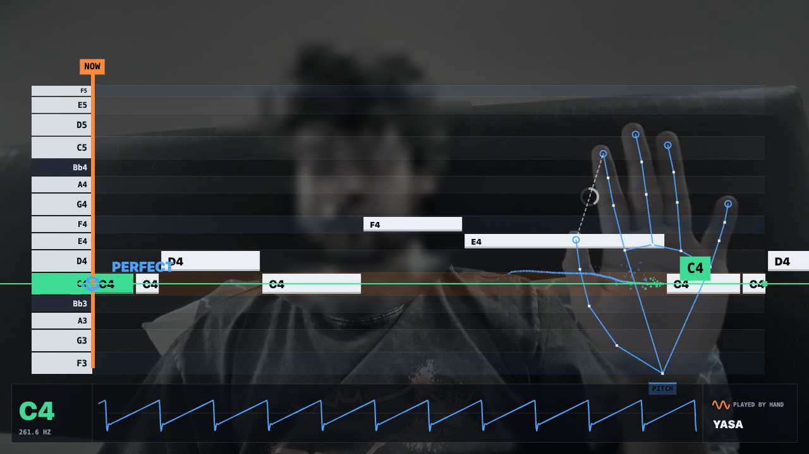

# Gesture Theremin

Play a theremin with your bare hands. Your webcam tracks both hands in real time and turns their position into pitch and volume. Runs entirely in the browser.



## Demo
See `gesture-theremin-demo.mp4`.

## Run
```bash
python3 -m http.server 8000
```
Open http://localhost:8000 in Chrome and allow camera access.

## How it works
- MediaPipe Hand Landmarker tracks hand landmarks from the webcam.
- Hand position maps to pitch and volume.
- Web Audio API synthesizes the sound.

## Privacy
Video frames stay on your device. Nothing is uploaded.

## Stack
JavaScript, MediaPipe Tasks Vision, Web Audio API. No build step.
